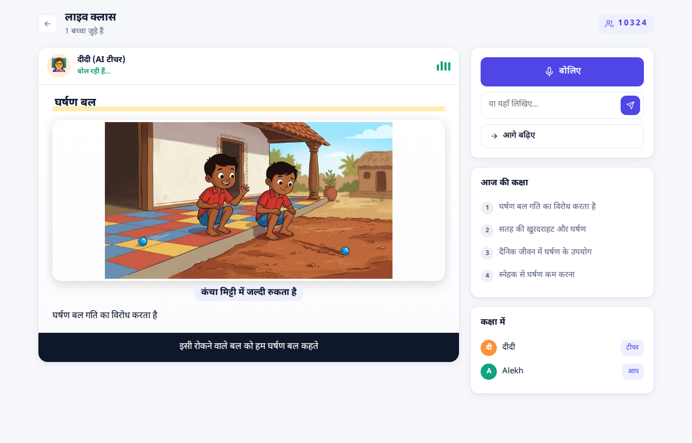
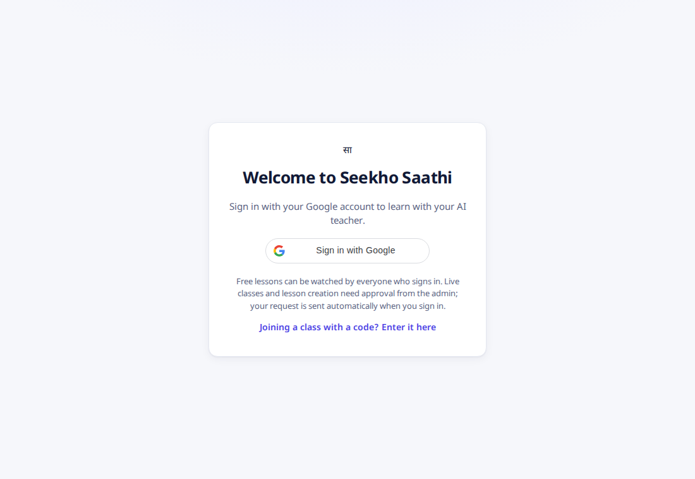
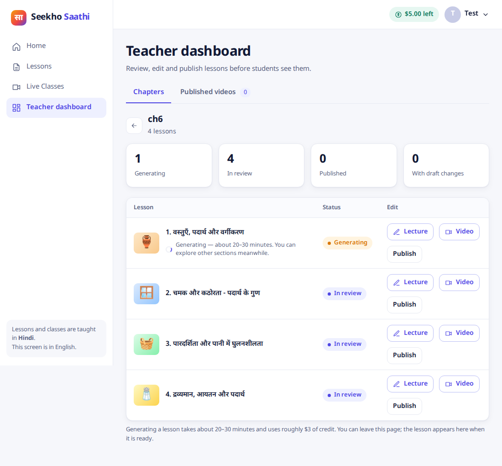

# Seekho Saathi — an AI teacher for rural India

An AI teacher that speaks the student's own language (Hindi first) while pictures, notes and diagrams appear on a white board, like a human teacher at a blackboard. Built for children in rural Bihar who often have no good teacher nearby. A human teacher always reviews a recorded lesson before students see it.



## What it does

| Part | What it is |
|---|---|
| **Recorded lessons** | A chapter PDF becomes short Hindi video lessons: narration, photos, notes, question cards. Generated offline, reviewed by a teacher, replayed from static files (cheap per view). |
| **Live class** | One AI teacher (Gemini Live, native audio) teaches a room of children. Children join with a 5-digit code, hold a button to answer or to ask their own doubt. The teacher shows one screen at a time (picture, figure, key words), asks questions, waits for the answers and checks them. |
| **Teacher dashboard** | Upload a chapter, generate a lesson video as a background job, edit the lecture and the video by chatting with an editing agent (proposals, accept/reject, versions, undo), then publish. |
| **Student chat** | Ask a quick question by text, voice or photo. |
| **Access and credit** | Sign in with Google. A new user's request is sent to the admin automatically; the admin grants credit. Free lessons stay open. |

| Sign in | Teacher dashboard |
|---|---|
|  |  |

## Architecture in one page

```
apps/web              React + Vite + TypeScript app (mobile-first, one design system in src/ui.css)
services/api          FastAPI backend, Google ADK agents, Gemini on Vertex AI
  src/ai_teacher_api/
    common/           settings, lesson schema, TTS, resilience, logging, picture generation
    content/          chapter parsing, planning, the lesson pipeline (ADK Workflow)
    authoring/        Agent 1: illustrated lecture, reviewers, editor loop
    director/         Agent 2: turns a lecture into a timed lesson, code repairs, voice
    teacher/          dashboard API, lecture and video editing agents, background jobs
    tutor/            student chat, class notes (Google Search)
    live/             the live class: room, session, tools, planning, judge
    access/           sign-in, users, credit, requests, admin API
    safety/           child-safety policy and topic gate
packages/lesson-schema  the lesson format shared by the backend and the player
deploy/               Cloud Run deploy script
docs/                 DEPLOY.md, DEBUGGING.md
tests/e2e             browser and API end-to-end scripts (need running servers)
```

Every lesson, recorded or live, is the same idea: narration plus timed board events. The board state is a pure function of time, so seek and replay are always consistent (`apps/web/src/player/board.ts`).

### The live class

- **One Gemini Live session per room**, broadcast to every child over a WebSocket. Push-to-talk: a child's microphone is heard only while they hold the button, so side talk and the loudspeaker never reach the teacher.
- **Planning first.** For a topic class the system writes class notes (with Google Search), plans steps, draws pictures and writes HTML figures in parallel, checks each picture with a vision model, and gives the teacher a *catalog* describing what every item really shows.
- **Tools the teacher uses:** `show_screen` (one screen at a time), `draw_picture` / `draw_html` (make a new visual when the catalog has none), `wait_for_answer` (ask aloud, then wait: the server transcribes the child's answer and a separate judge gives the verdict), `plan`, `finish_class`.
- **Safety nets in code:** idle watcher (she never stalls), nudges when a child's question got only a screen change and no spoken answer, a reminder to show a drawn visual that is ready, answer verification, markup and wrong-script filters on captions.
- **Every state change is logged with its reason** (`logs/live.jsonl`, event `state`), so a class can be followed step by step. See `services/api/src/ai_teacher_api/live/README.md` and `docs/DEBUGGING.md`.

## Run it locally

You need Python 3.12+, [uv](https://docs.astral.sh/uv/), Node 22+, and a Google Cloud project with Vertex AI enabled (`gcloud auth application-default login`). The models used are Gemini text, image, live and TTS models on Vertex AI; set `GOOGLE_CLOUD_PROJECT` to your own project.

```bash
# backend (no sign-in locally: AUTH_MODE=off makes you a local admin)
cd services/api
uv sync
GOOGLE_CLOUD_PROJECT=<your-project> AUTH_MODE=off uv run uvicorn ai_teacher_api.server:root --port 8001

# web app (second terminal); open http://localhost:5198
cd apps/web
npm install
API_URL=http://localhost:8001/api npm run dev -- --port 5198
```

Useful settings (environment variables):

| Variable | Meaning |
|---|---|
| `GOOGLE_CLOUD_PROJECT` | your Vertex AI project |
| `AUTH_MODE` | `off` for local development, `on` for real sign-in |
| `GOOGLE_CLIENT_ID` | Google OAuth Web client ID (sign-in) |
| `ADMIN_EMAILS` | comma-separated admin emails (default: the author's) |
| `CONTACT_EMAIL` | shown to users whose approval is delayed |
| `START_CREDIT_USD`, `DAILY_CAP_USD` | credit given on approval, daily spending cap |
| `TEXT_MODEL`, `LIVE_MODEL`, `LIVE_LOCATION` | model choices |
| `STORE`, `DATA_BUCKET`, `STORE_PREFIX` | `firestore` + bucket for production, local files otherwise |
| `KIT_CACHE=1` | development only: reuse a topic's prepared pictures and figures instead of preparing them again |

Tests:

```bash
cd services/api && uv run pytest -q     # backend, no network needed
cd apps/web && npx tsc -b               # type check
```

End-to-end scripts in `tests/e2e` drive real browsers and the real models (they cost a little); see their headers.

## Make a lesson from a chapter

Put a chapter PDF anywhere (the NCERT chapters are free to download from ncert.nic.in; they are not included in this repository) and run:

```bash
cd services/api
uv run python -m ai_teacher_api.content.pipeline path/to/chapter.pdf ../../data/ch6 --book "NCERT Class 6 Science, Ch. 6"
```

The pipeline is resumable. Or upload the PDF in the teacher dashboard and press Generate; a lesson takes about 20 to 30 minutes.

## Deploy

One container serves the built web app and the API on Cloud Run. See [docs/DEPLOY.md](docs/DEPLOY.md) and `deploy/deploy.sh`.

## Status and known limits

- The live class has been tested with simulated children and a real teacher voice; it has **not** yet been tested with real phones, microphones, speakers or weak networks.
- The teacher's speaking pace is the model's own; the Live API has no speed setting.
- Pictures are checked by AI reviewers, and a person should still look at a lesson before publishing it.
- Design decisions and history are in [CLAUDE.md](CLAUDE.md) and [PLAN.md](PLAN.md).

## License

No license has been chosen yet. All rights are reserved by the author until one is added.
